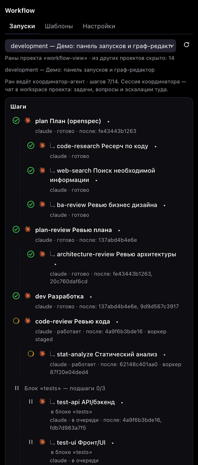
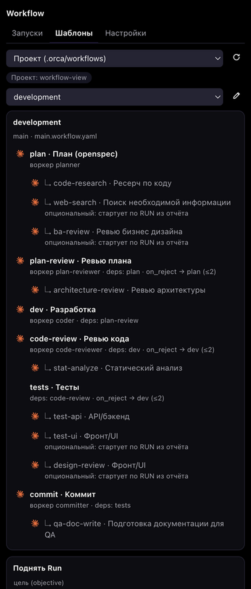
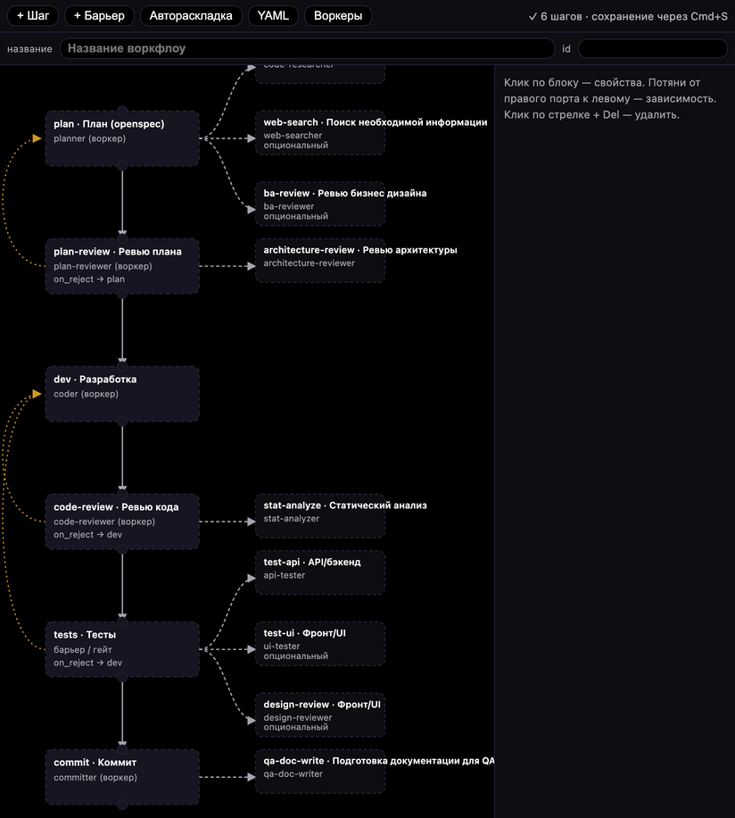
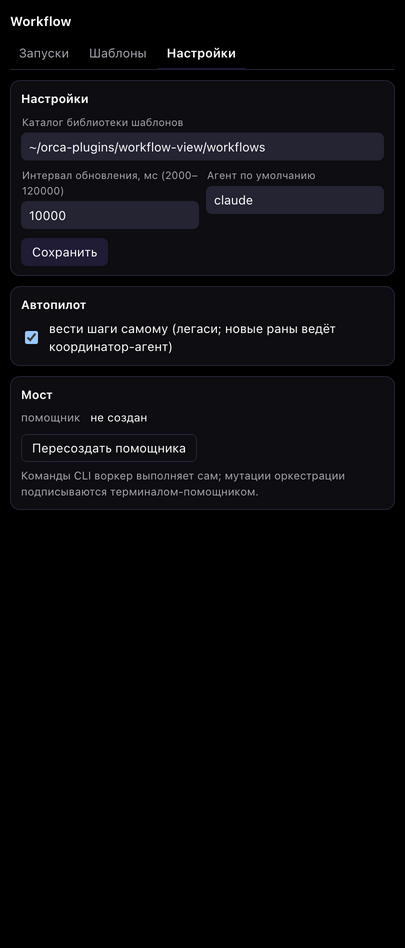

# orca-workflow

Плагин для [Orca](https://orca.stably.ai): продуктовые воркфлоу для агентной разработки —
шаблоны пайплайнов на проект, визуальный граф-редактор, панель ранов с гейтами и отчётами,
и живой **координатор-агент**, который ведёт конвейер от постановки задачи до коммита.

Идея проста: один раз описываешь воркфлоу — дальше ставишь задачу координатору,
и конвейер идёт сам: план → ревью → разработка → ревью кода → тесты → коммит.
Циклы доработки решает вердикт ревьюера, вопросы воркеров закрывает координатор,
а к человеку попадают только настоящие развилки.

| Панель ранов | Шаблон |
|---|---|
|  |  |

| Граф-редактор шаблона | Настройки |
|---|---|
|  |  |

```
┌───────────────────────── Workflow (панель) ─────────────────────────┐
│ Запуски  Шаблоны  Настройки                                         │
│ ─────────────────────────────────────────────────────────────────── │
│ Ран ведёт координатор-агент · шагов 3/9                             │
│ ✓ plan · План (openspec)          [claude]                          │
│ ✓ plan-review · Ревью плана       [claude]   ← on_reject → plan     │
│ ▸ dev · Разработка                [claude]   ⏿ гейт                 │
│ ❑ Блок «tests» — подшаги 0/3                                        │
│   ↳ test-api  ↳ test-static  ↳ test-ui                              │
└─────────────────────────────────────────────────────────────────────┘
```

## Из чего состоит

| Часть | Что делает |
| --- | --- |
| `src/panel.html` | HTML-панель в сайдбаре: раны (шаги, подшаги, гейты, отчёты, ретраи), шаблоны (превью, форма поднятия, копирование), настройки. Бренд-иконки агентов (Claude/Codex/Copilot) — инлайн-SVG |
| `src/worker.ts` | Воркер плагина: мост к `orca` CLI в служебном терминале, материализация шаблона в ран (tasks/gates), запуск координатора, запросы панели |
| `src/editor/` | Граф-редактор `.workflow.yaml` (custom editor): вертикальная цепочка, подшаги блоками справа, возвраты on_reject дугами слева, инспектор с комбобоксами, менеджер воркеров |
| `src/workflow.ts`, `src/yaml.ts` | Схема шаблона и строгий мини-YAML (терпит запятые и списки без дефисов при ручной правке) |
| `workflows/`, `workers/` | Библиотека: переносимый шаблон feature-dev и карточки воркеров, копируются в проект одним кликом |

## Схема шаблона (`.orca/workflows/*.workflow.yaml`)

```yaml
id: main
title: 'development'
steps:
  - id: plan
    title: 'План (openspec)'
    worker: planner                      # карточка из .orca/workers/
    sub:                                 # параллельный блок подшагов
      - { id: code-research, title: 'Ресерч по коду', worker: code-researcher, optional: true }
  - id: plan-review, 
    title: 'Ревью плана', 
    worker: plan-reviewer,
    gate: { question: 'Подтверждаем план?', options: [approve, request-changes] },
    on_reject: { goto: plan, max_rounds: 2 }   # вердикт ревью вернёт работу назад
  - id: dev
    worker: coder
    fallback: [codex, zcode]             # фейловер: цепочка агентов при провале шага
  - id: tests
    sub:
      - { id: test-api, worker: api-tester }
      - { id: test-ui, worker: ui-tester, optional: true }
```

- **`worker:`** — slug карточки из `.orca/workers/` (старое имя `specialist:` работает как синоним).
  Шаги без deps идут цепочкой по порядку; явный `deps:` строит DAG.
- **`sub:`** — параллельный блок: подшаги идут одновременно, следующий шаг ждёт весь блок.
  `optional: true` — подшаг стартует, только если родитель написал `RUN: <id>` в отчёте.
- **`on_reject`** — цикл доработки: ревьюер заканчивает отчёт строкой
  `VERDICT: approve` или `VERDICT: request-changes`; при возврате целевой шаг перезапускается
  с замечаниями, затем ревью проверяет снова (≤ max_rounds).
- **`fallback:`** — при провале шага конвейер перезапускает его на следующем агенте цепочки.
- **`gate:`** — подтверждение человека: гейт пишется рядом с шагом, результат которого
  подтверждают, а держит следующий шаг (он не начнётся без ответа).
- **`skip` в `gate.options` + `on_skip`** — разрешение пропустить шаг, который держит гейт:
  в панели появляется кнопка «skip — пропустить». Без `on_skip` пропускается только этот шаг,
  `on_skip: { goto: <id> }` продолжает с указанного шага, пропуская всё между. Работающие и
  завершённые задачи не трогаются; пропущенное возвращается «Перезапустить шаг».
  `on_skip` указывает только вперёд — назад ведёт `on_reject`.
- **Плейсхолдеры** `{{objective}}`, `{{repo}}`, `{{base_branch}}`, `{{worktree}}` подставляются при поднятии рана.

## Воркеры (`.orca/workers/`)

Каталоги можно группировать по шагам — папки названы по id воркера/шага:

```
.orca/workers/
  planner.yaml  coder.yaml  committer.yaml  coordinator.yaml
  plan/code-researcher.yaml  plan/web-researcher.yaml
  tests/api-tester.yaml  tests/ui-tester.yaml
```

Ссылка в шаблоне — плоским именем файла (`worker: code-reviewer`), вложенность не важна.
Карточка:

```yaml
agent: claude          # или codex, zcode, …
model: opus            # опц.
effort: high           # опц., только вместе с model (claude: low..xhigh/max)
parallel: 2            # опц., макс. одновременных экземпляров воркера в ране (нет — без лимита)
fallback: [codex]      # опц., цепочка агентов при провале
prompt: |
  Задача: {{objective}}.
  Ты — независимый ревьюер. …
```

`parallel` развязывает или ограничивает руки координатору: карточка `parallel: 1`
сериализует все шаги этого воркера (дорогая модель, квоты), `parallel: 3` — разрешает
до трёх экземпляров одновременно; лимит попадает в бриф координатора («ОДНОВРЕМЕННО
не более N») и в превью шаблона («≤N паралл.»).

Подшаги (`sub:`) имеют **явную фазу** относительно родителя:

```yaml
sub:
  - { id: code-research, worker: code-researcher, phase: before_start }   # до старта воркера плана
  - { id: side-check, worker: reviewer, phase: parallel }                 # параллельно с воркером плана
  - { id: verify, worker: verifier, phase: before_end }                   # после работы, до отчёта
  - { id: web-search, worker: web-researcher, phase: after_end, optional: true }  # после отчёта (RUN:)
```

- `before_start` — **до старта воркера** родителя: подшаг готовит его, родитель ждёт.
- `parallel` — **параллельно с воркером** родителя: стартуют вместе, родителя не блокирует, но шаг закрыт только парой отчётов.
- `before_end` — **после работы воркера, до вывода отчёта**: воркер завершает работу → подшаг проверяет/дополняет → только тогда отчёт шага считается финальным и флоу идёт дальше (верификация внутри шага).
- `after_end` — **после отчёта**: родитель пишет `RUN: <id>` в отчёте, координатор запускает подшаг, пересылая список вопросов; флоу не блокирует.
- `optional: true` — условная необходимость: не той это задаче (нет бэкенда — нет бэкенд-проверки) — координатор пропускает; не начат — ничего не блокирует.

Дефолты: обязательный подшаг = `before_end` (после работы воркера, до отчёта), опциональный = `after_end`. Других имён нет.

`prompt` — системный промт воркера (плейсхолдеры `{{objective}}/{{repo}}/{{base_branch}}/{{worktree}}`
подставляются при старте). Промт может отправлять воркера к скилам и субагентам проекта
(`.claude/skills/*`, `.claude/agents/*`) — агент в ворктри видит их автоматически.

Создавать/править/удалять карточки можно из граф-редактора — кнопка «Воркеры» в тулбаре.

### Координатор своего флоу — `coordinator-<id шаблона>`

На каждый флоу — свой координатор. Он выбирается по имени карточки, поле в шаблоне не нужно:

```
.orca/workers/
  coordinator.yaml                 # общий — для флоу без своей карточки
  coordinator-test-design.yaml     # координатор флоу test-design
  coordinator-bugfix.yaml          # координатор флоу bugfix
```

- Карточка `coordinator-<id>` заменяет общую целиком: агент, модель и effort — свои.
- Её текст попадает в бриф координатора блоком «Роль и специфика этого флоу»: что уточнить в
  первом ходе, какие факты передавать между шагами, что решает человек, что попадёт в итоговый
  отчёт. Команды движка и общие правила координатора дублировать не нужно — они уже в брифе.
- Из **общей** `coordinator.yaml` агенту уходят только агент, модель и effort; её текст не
  отправляется — правила координатора зашиты в бриф. Специфику флоу пиши в `coordinator-<id>`.
- Битая карточка координатора останавливает подъём до создания рана и называет карточку.

## Координатор-агент

Координатором становится сессия, которой передан бриф: плагин поднимает её сам при
«Поднять Run» (цель берётся из формы). Бриф также сохраняется в
`<ворктри рана>/.orca/coordinator-brief.<RUN_ID>.md` — у каждого рана свой файл, в одном
воркспейсе может жить несколько ранов — и роль переносима: любая сессия в ворктри может стать
координатором двумя командами:

```bash
orca orchestration run-use --id <RUN_ID> --json   # привязаться к рану
cat .orca/coordinator-brief.<RUN_ID>.md           # взять флоу и правила
```

Цель в форме — опциональная затравка: оставь пустой, и **первый ход координатора — интервью
в его чате** («что будем делать? границы? критерии?»); собранное описание он пересылает
планировщику при старте (`orchestration send`). Заполненная цель идёт в бриф, заголовок рана
и через `{{objective}}` в промты воркеров.

«Поднять Run» делает четыре вещи: создаёт ран и задачи, материализует гейты,
запускает **сессию координатора** (claude в workspace проекта) и передаёт ей бриф —
цель, весь флоу, правила. Координатор:

- привязывается к рану (`run-use`) и ведёт шаги по порядку;
- читает отчёты воркеров, крутит VERDICT-циклы доработки;
- отвечает на вопросы воркеров из ящика рана (`check`/`reply`) — сам, без человека;
- **эскалирует в свой чат**, когда решить не может: пишет суть, варианты, рекомендацию —
  человек отвечает прямо в сессии координатора;
- уважает гейты: шаг за гейтом не стартует без ответа человека.

Свой координатор на флоу — карточка `coordinator-<id шаблона>` с ролью и спецификой этого флоу
([«Координатор своего флоу»](#координатор-своего-флоу--coordinator-id-шаблона)).

Для ранов, поднятых до появления координатора, остаётся кодовый автопилот (fallback).

### В каком воркспейсе поднимается ран

Поле «имя ворктри» — это имя воркспейса Орки:

- воркспейс с таким именем уже есть — ран поднимается **в нём**: новая сессия координатора, тот
  же воркспейс и та же ветка. Новый ворктри не создаётся, а поле «ветка (опц.)» блокируется —
  у воркспейса ветка уже есть (панель пишет об этом под полем). Так поднимают тест-дизайн и
  ревью к коду, который лежит в готовом воркспейсе. Ранов в одном воркспейсе может быть
  несколько — панель показывает самый свежий.
- такого воркспейса нет — создаётся новый ворктри с этим именем: от «base branch», на ветке из
  «ветка (опц.)».

## Установка

```sh
orca plugin install git@github.com:EmptyWave/orca-workflow.git --approve <fingerprint>
```

Требуется Orca ≥ 1.4.248. Плагин запрашивает: терминалы (мост к CLI), workspace,
чтение агентов и запуск агентских сессий (координатор), storage/settings.

Первый запуск в проекте: открой панель Workflow → «Шаблоны» → источник «Библиотека» →
«↳ в проект» — шаблон и карточки воркеров скопируются в `<repo>/.orca/`.

## Разработка

```sh
git clone git@github.com:EmptyWave/orca-workflow.git && cd orca-workflow
npx -y -p typescript@5.9 tsc -p .        # типы
orca plugin test .                        # 33 теста: yaml, workflow, worker (мок моста), editor
orca plugin validate .
orca plugin dev load .                    # живая разработка; правки подхватываются reload'ом
orca plugin shot local.workflow-view --panel workflow --out .orca/shots/x.png
```

## Документация

- [`docs/orca-notes.md`](docs/orca-notes.md) — опыт работы с Orca: host API, CLI, dev-цикл, все грабли.
- [`docs/internals.md`](docs/internals.md) — полная логика плагина: мост, схема шаблона, фазы, координатор, панель, редактор.

## Как это устроено внутри

- **Мост.** Плагинового API у оркестрации нет, но trusted-worker может запускать `orca`
  CLI сам: команды спавнятся в процессе воркера (`bash -c`), без терминалов и без
  зависимости от того, какой воркспейс сейчас в фокусе. Мутациим оркестрации нужен
  идентификатор отправителя (`--from <handle>`): воркер один раз создаёт CLI-шный
  терминал-помощник «workflow-view-runner» в воркспейсе проекта и переиспользует его
  (пересоздаёт при `stable_pane_required`); команды без `--from` автоматически
  повторяются с ним после `no_active_sender_terminal`. Терминалов в чужих проектах не
  появляется — терминал-помощник один, живёт в проекте панели.
- **Панель** — изолированный HTML-фрейм: полный контроль DOM, темы через `--orca-*`,
  состояние в storage плагина. Читает готовые снимки рана из storage; мост трогает
  только воркер. При ошибке обновления старые данные не стираются.
- **Скоупинг.** Раны привязаны к проектам (мета пишется при создании), панель фильтрует
  по фокусному проекту; проект без ранов открывает вкладку «Шаблоны». Фокус в воркспейсе
  без воркфлоу (домашняя папка, другой проект) не опустошает панель: скоуп удерживается на
  проекте последнего рана. Если проект и вовсе не определился — вкладка «Шаблоны»
  показывает библиотеку вместо тупика; кнопка ↻ доступна в любом состоянии.

## Удаление ранов

Движок не даёт команды удаления, поэтому панель делает это сама: кнопка **✕** рядом с
селектором рана удаляет ран целиком (задачи, гейты, отчёты, воркеров) — записью в
`orchestration.db` движка (его схема несёт DELETE-триггеры), с отказом, если у рана есть
**работающие** воркеры. Мета плагина (runmeta/auto) чистится вместе с ним.

## Ограничения

- Редактор типизирован под нашу схему (шаг/барьер/подшаг), это не общий Excalidraw.
- Гейт на чистом блоке (без своего воркера) вешается на первый следующий шаг.
- Кросс-провайдерный фейловер по квотам не отслеживается — fallback срабатывает по факту провала.
